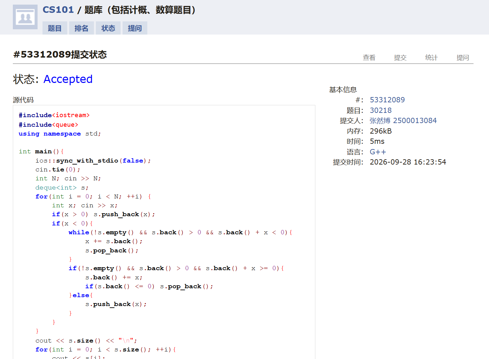
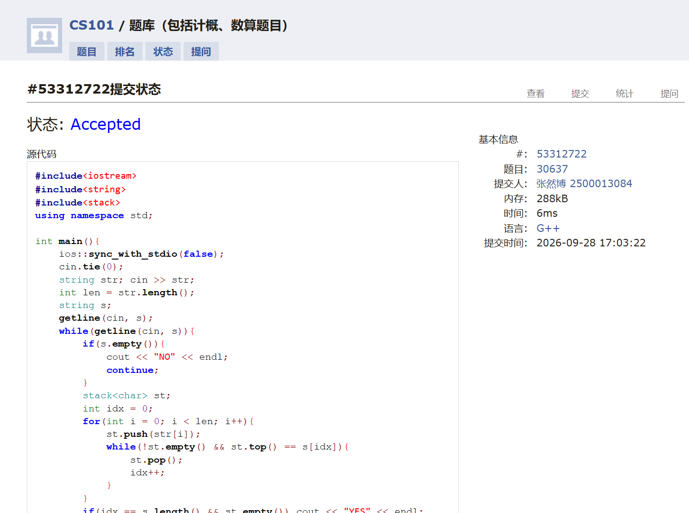
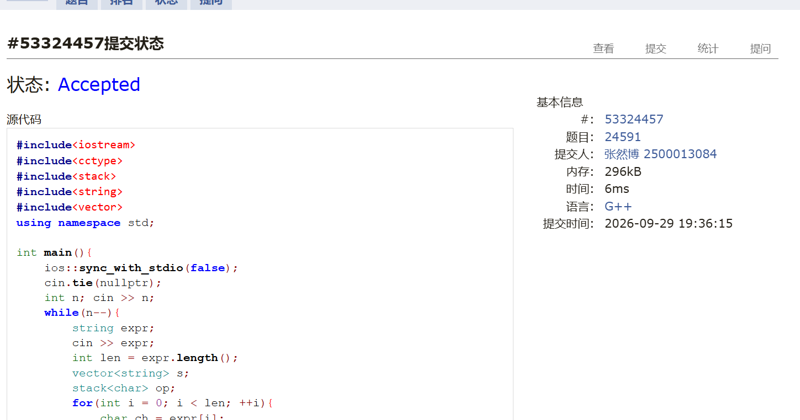
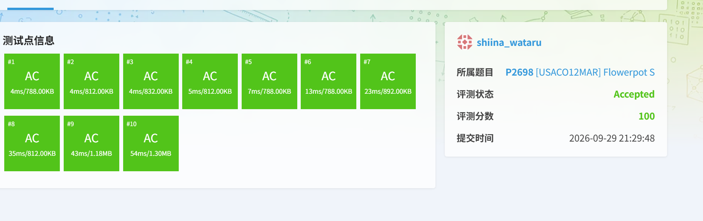
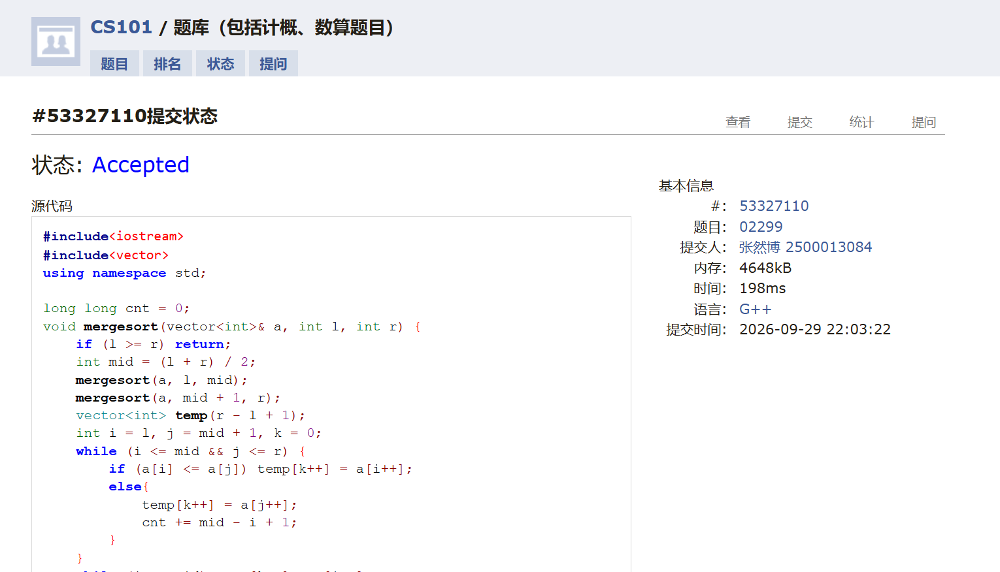
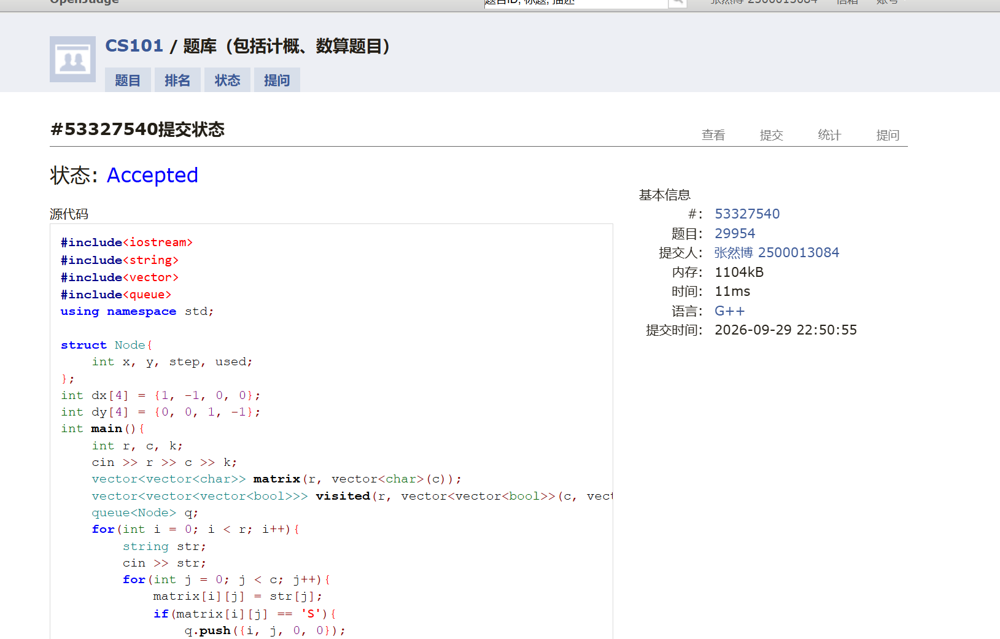

# DSA Assignment #3: 栈 & 队列

*Updated: 2026-09-22 13:27 (GMT+8)*  
*完成学生：<mark>张然博，信息科学技术学院</mark>*


>**说明：**
>
>截止日期：前三周作业统一于 9月29日 提交至 Canvas 平台。
>
>内容要求：每个题目包含：**解题思路**（可选）、**源代码**、**Accepted 截图**、**预估耗时**（可选）。
>


## 1. 题目

### M30218:狭路相逢

stack, http://cs101.openjudge.cn/practice/30218/

思路：
用一个栈来模拟整个过程。


预估耗时：
5ms


代码

```cpp
#include<iostream>
#include<queue>
using namespace std;

int main(){
    ios::sync_with_stdio(false);
    cin.tie(0);
    int N; cin >> N;
    deque<int> s;
    for(int i = 0; i < N; ++i) {
        int x; cin >> x;
        if(x > 0) s.push_back(x);
        if(x < 0){
            while(!s.empty() && s.back() > 0 && s.back() + x < 0){
                x += s.back();
                s.pop_back();
            }
            if(!s.empty() && s.back() > 0 && s.back() + x >= 0){
                s.back() += x;
                if(s.back() <= 0) s.pop_back();
            }else{
                s.push_back(x);
            }
        }
    }
    cout << s.size() << "\n";
    for(int i = 0; i < s.size(); ++i){
        cout << s[i];
        if(i != s.size() - 1) cout << " ";
    }
    return 0;
}
```


代码运行截图 <mark>（至少包含有"Accepted"）</mark>



### M30637: 合法出栈序列pub

stack, http://cs101.openjudge.cn/practice/30637/

思路：
使用一个栈来模拟出栈过程。对于每个输入的出栈序列，我们依次将元素压入栈中，同时检查是否可以按照给定的顺序弹出元素。如果所有元素都能正确弹出，则该序列是合法的。

具体实现就是逐渐往栈里压元素，然后用一个索引来跟踪当前出栈序列的位置，如果栈顶元素与出栈序列的当前元素匹配，就弹出栈顶元素并移动索引，直到所有元素都处理完毕。

预估耗时：
6ms


代码

```cpp
#include<iostream>
#include<string>
#include<stack>
using namespace std;

int main(){
    ios::sync_with_stdio(false);
    cin.tie(0);
    string str; cin >> str;
    int len = str.length();
    string s;
    getline(cin, s);
    while(getline(cin, s)){
        if(s.empty()){
            cout << "NO" << endl;
            continue;
        }
        stack<char> st;
        int idx = 0;
        for(int i = 0; i < len; i++){
            st.push(str[i]);
            while(!st.empty() && st.top() == s[idx]){
                st.pop();
                idx++;
            }
        }
        if(idx == s.length() && st.empty()) cout << "YES" << endl;
        else cout << "NO" << endl;
    }
    return 0;
}
```


代码运行截图 <mark>（至少包含有"Accepted"）</mark>



### M24591:中序表达式转后序表达式

stack, http://cs101.openjudge.cn/practice/24591/

思路：
调度场算法。


预估耗时：
6ms


代码

```cpp
#include<iostream>
#include<cctype>
#include<stack>
#include<string>
#include<vector>
using namespace std;

int main(){
    ios::sync_with_stdio(false);
    cin.tie(nullptr);
    int n; cin >> n;
    while(n--){
        string expr;
        cin >> expr;
        int len = expr.length();
        vector<string> s;
        stack<char> op;
        for(int i = 0; i < len; ++i){
            char ch = expr[i];
            if(isdigit(ch)){
                int nextop = expr.find_first_of("+-*/()", i);
                if(nextop == string::npos) nextop = len;
                s.push_back(expr.substr(i, nextop - i));
                i = nextop - 1;
            }
            if(ch == '('){
                op.push(ch);
            }
            if(ch == ')'){
                while(!op.empty() && op.top() != '('){
                    s.push_back(string(1, op.top()));
                    op.pop();
                }
                op.pop();
            }
            if(ch == '+' || ch == '-'){
                while(!op.empty() && op.top() != '('){
                    s.push_back(string(1, op.top()));
                    op.pop();
                }
                op.push(ch);
            }
            if(ch == '*' || ch == '/'){
                while(!op.empty() && op.top() != '(' && op.top() != '+' && op.top() != '-'){
                    s.push_back(string(1, op.top()));
                    op.pop();
                }
                op.push(ch);
            }
        }
        while(!op.empty()){
            s.push_back(string(1, op.top()));
            op.pop();
        }
        for(int i = 0; i < s.size(); ++i){
            cout << s[i] << (i == s.size() - 1 ? '\n' : ' ');
        }
    }
    return 0;
}
```


代码运行截图 <mark>（至少包含有"Accepted"）</mark>



### P2698 [USACO12MAR] Flowerpot S

monotonic queue, https://www.luogu.com.cn/problem/P2698

思路：
可以看出，对于每个给定的花盆宽度 $w$，都可以使用滑动窗口在 $O(n)$ 的时间复杂度求出所对应的 $d_{max}$。
然后我们对 $W$ 的取值范围做二分，就能以 $O(n \log n)$ 的时间复杂度求出最小的 $W$ 使得 $d_{max}$ 要满足条件。


预估耗时：
4ms-54ms


代码

```cpp
#include<iostream>
#include<algorithm>
#include<queue>
using namespace std;

struct point{
    int x, y;
};
int n, D;
point arr[100005];
bool check(int width){
    deque<int> maxdq;
    deque<int> mindq;
    int delta = 0;
    for(int i = 0; i < n; i++){
        while(!maxdq.empty() && arr[maxdq.back()].y <= arr[i].y) maxdq.pop_back();
        maxdq.push_back(i);
        while(!mindq.empty() && arr[mindq.back()].y >= arr[i].y) mindq.pop_back();
        mindq.push_back(i);
        while(!maxdq.empty() && arr[maxdq.front()].x < arr[i].x - width) maxdq.pop_front();
        while(!mindq.empty() && arr[mindq.front()].x < arr[i].x - width) mindq.pop_front();
        delta = max(delta, arr[maxdq.front()].y - arr[mindq.front()].y);
    }
    return delta >= D;
}

int main(){
    ios::sync_with_stdio(false);
    cin.tie(nullptr);
    cin >> n >> D;
    for(int i = 0; i < n; i++) cin >> arr[i].x >> arr[i].y;
    sort(arr, arr + n, [](const point &a, const point &b){return a.x < b.x;});
    int left = 0, right = 1000000;
    if(!check(right)){
        cout << -1 << endl;
        return 0;
    }
    while(left < right){
        int mid = (left + right) / 2;
        if(check(mid)) right = mid;
        else left = mid + 1;
    }
    cout << left << endl;
    return 0;
}
```


代码运行截图 <mark>（至少包含有"Accepted"）</mark>



### M02299: Ultra-QuickSort

merge sort, http://cs101.openjudge.cn/practice/02299/

思路：
注意到每次交换恰好是将逆序对的数量减一，最终排序完恰好是逆序对的数量为零，所以我们只需要计算逆序对的数量即可。

使用归并排序的过程中计算逆序对的数量，时间复杂度为 $O(n \log n)$。


预估耗时：
198ms


代码

```cpp
#include<iostream>
#include<vector>
using namespace std;

long long cnt = 0;
void mergesort(vector<int>& a, int l, int r) {
    if (l >= r) return;
    int mid = (l + r) / 2;
    mergesort(a, l, mid);
    mergesort(a, mid + 1, r);
    vector<int> temp(r - l + 1);
    int i = l, j = mid + 1, k = 0;
    while (i <= mid && j <= r) {
        if (a[i] <= a[j]) temp[k++] = a[i++];
        else{
            temp[k++] = a[j++];
            cnt += mid - i + 1;
        }
    }
    while (i <= mid) temp[k++] = a[i++];
    while (j <= r) temp[k++] = a[j++];
    for (int i = 0; i < k; i++) a[l + i] = temp[i];
}

int main() {
    int n;
    while(cin >> n) {
        if (n == 0) break;
        vector<int> a(n);
        cnt = 0;
        for (int i = 0; i < n; i++) cin >> a[i];
        mergesort(a, 0, n - 1);
        cout << cnt << endl;
    }
}
```


代码运行截图 <mark>（至少包含有"Accepted"）</mark>



### M29954:逃离紫罗兰监狱

bfs, http://cs101.openjudge.cn/practice/29954 

思路：
维护状态使用了几次破墙的次数，使用 BFS 来搜索最短路径。每次移动时，如果遇到墙且破墙次数未达到上限，则可以选择破墙并继续搜索。


预估耗时：
11ms


代码

```cpp
#include<iostream>
#include<string>
#include<vector>
#include<queue>
using namespace std;

struct Node{
    int x, y, step, used;
};
int dx[4] = {1, -1, 0, 0};
int dy[4] = {0, 0, 1, -1};
int main(){
    int r, c, k;
    cin >> r >> c >> k;
    vector<vector<char>> matrix(r, vector<char>(c));
    vector<vector<vector<bool>>> visited(r, vector<vector<bool>>(c, vector<bool>(k + 1, false)));
    queue<Node> q;
    for(int i = 0; i < r; i++){
        string str;
        cin >> str;
        for(int j = 0; j < c; j++){
            matrix[i][j] = str[j];
            if(matrix[i][j] == 'S'){
                q.push({i, j, 0, 0});
            }
        }
    }
    while(!q.empty()){
        Node node = q.front();
        q.pop();
        if(visited[node.x][node.y][node.used]) continue;
        visited[node.x][node.y][node.used] = true;
        if(matrix[node.x][node.y] == 'E'){
            cout << node.step << endl;
            return 0;
        }
        for(int i = 0; i < 4; i++){
            int nx = node.x + dx[i];
            int ny = node.y + dy[i];
            if(nx >= 0 && nx < r && ny >= 0 && ny < c){
                if(matrix[nx][ny] == '.' || matrix[nx][ny] == 'E'){
                    q.push({nx, ny, node.step + 1, node.used});
                }else if(matrix[nx][ny] == '#' && node.used < k){
                    q.push({nx, ny, node.step + 1, node.used + 1});
                }
            }
        }
    }
    cout << -1 << endl;
    return 0;
}
```


代码运行截图 <mark>（至少包含有"Accepted"）</mark>



## 2. 学习总结和收获

<mark>如果作业题目简单，有否额外练习题目，比如：OJ“数算2026fall每日选做”、CF、LeetCode、洛谷等网站题目。</mark>

