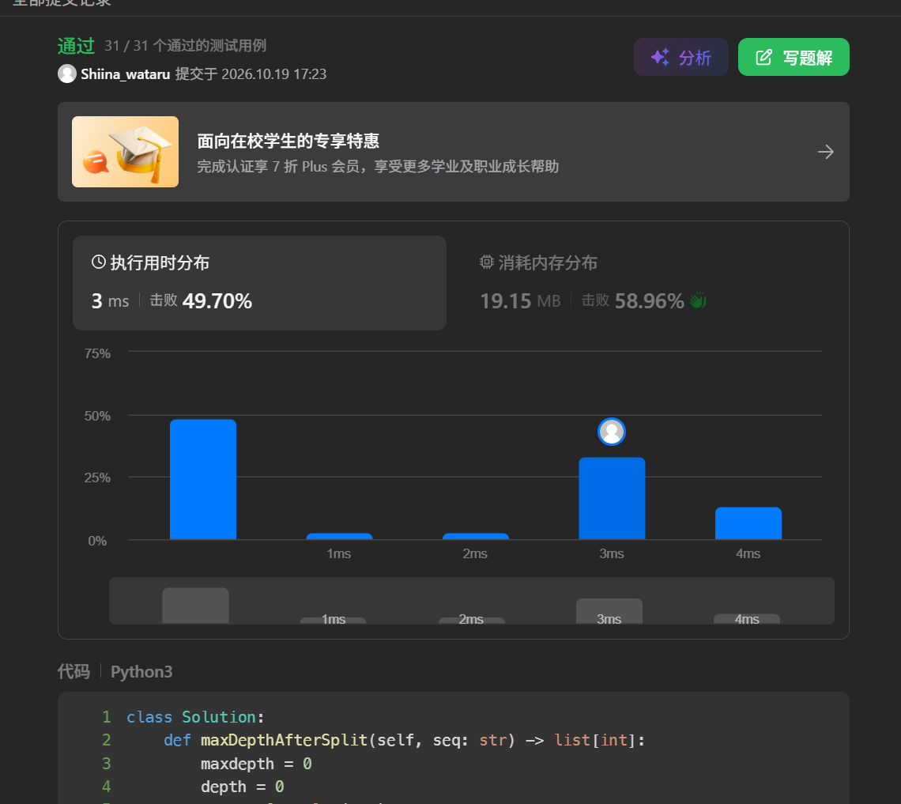
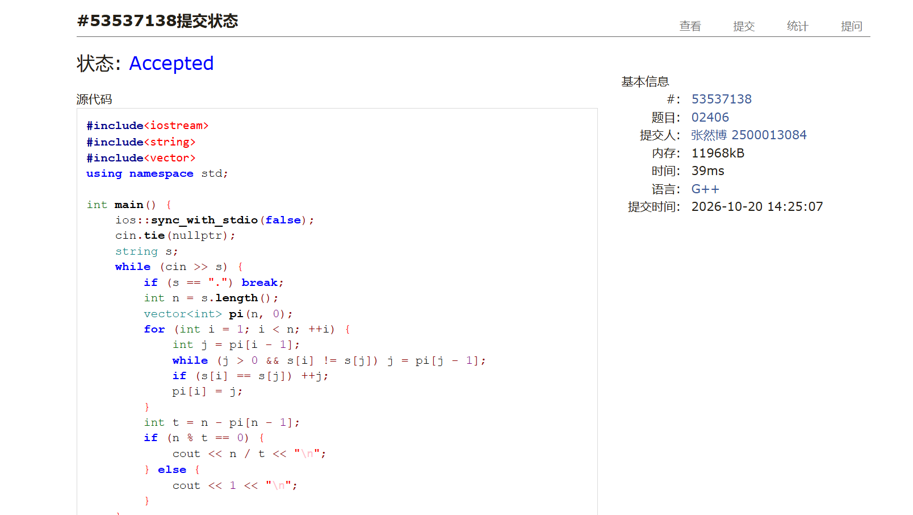
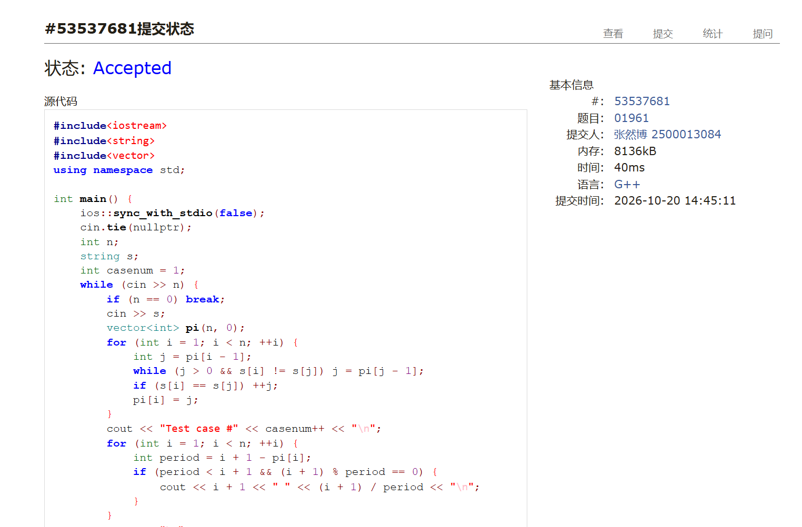
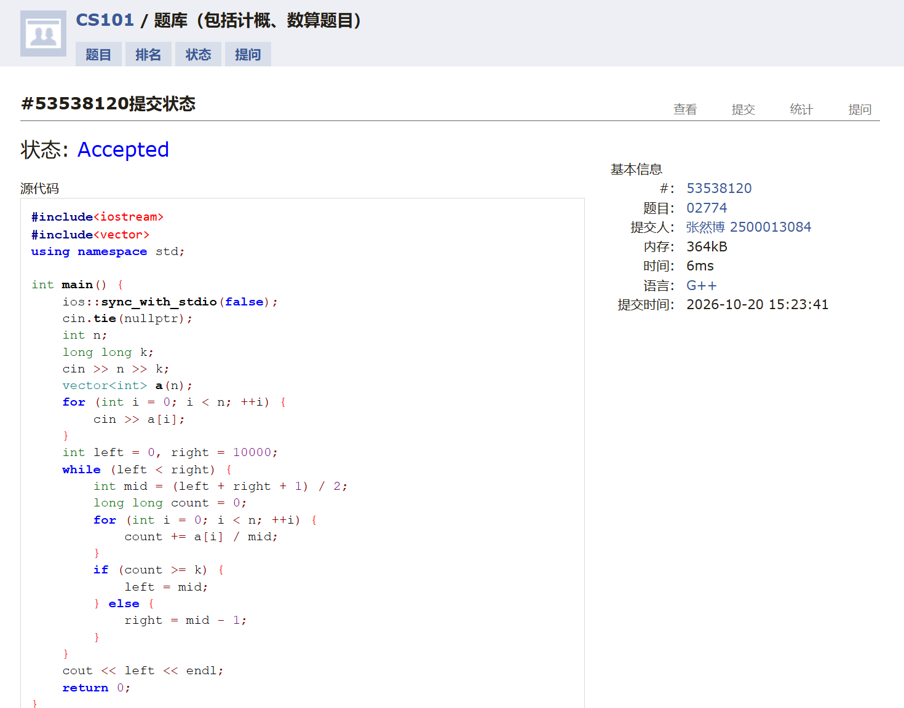
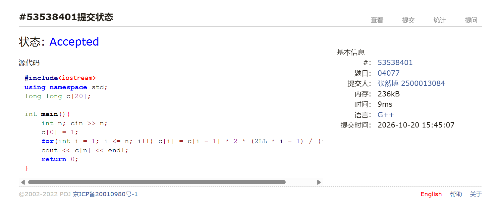
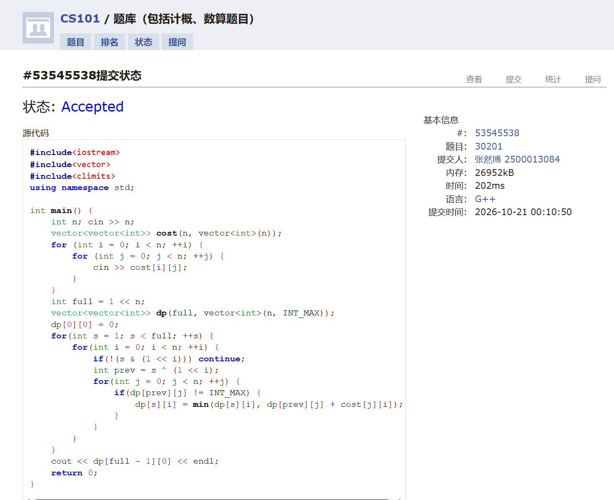

# DSA Assignment #4: 栈 & KMP

*Updated: 2026-09-30 18:02 (GMT+8)*  
*完成学生：<mark>张然博，信息科学技术学院</mark>*


>**说明：**
>
>内容要求：每个题目包含：**解题思路**（可选）、**源代码**、**Accepted 截图**、**预估耗时**（可选）。
>


## 1. 题目

### M1111.有效括号的嵌套深度

stack, https://leetcode.cn/problems/maximum-nesting-depth-of-two-valid-parentheses-strings/

思路：  
有效括号字符串（VPS）我发现可以计算每个括号所处的深度，抽象成一个多层级的结构，我们只需要将深度更高的一半的括号分为一组，深度更低的一半的括号分为另一组，这样就可以保证两组括号的嵌套深度的最大值最小。
具体来说，我们可以使用一个计数器来跟踪当前的深度，当遇到左括号时，深度加一，当遇到右括号时，深度减一。  
值得一提的是，我在题解上看到了我这种方法还有更好的优化，就是通过对深度进行奇偶性判断来直接分配组别，这样可以不去计算最大深度，减少计算量。


预估耗时：
3ms


代码

```python
class Solution:
    def maxDepthAfterSplit(self, seq: str) -> list[int]:
        maxdepth = 0
        depth = 0
        ans = [0] * len(seq)
        for ch in seq:
            depth += 1 if ch == '(' else -1
            maxdepth = max(maxdepth, depth)
        depth = 0
        for i, ch in enumerate(seq):
            if ch == '(':
                depth += 1
                ans[i] = 1 if depth <= maxdepth // 2 else 0
            else:
                ans[i] = 1 if depth <= maxdepth // 2 else 0
                depth -= 1
        return ans
```


代码运行截图 <mark>（至少包含有"Accepted"）</mark>



### 02406: 字符串乘方

KMP, http://cs101.openjudge.cn/practice/02406/

思路：  
计算出最长相等真前后缀数组 pi，通过 n - pi[n - 1] 找到最短周期，答案即为长度除以最短周期


预估耗时：
39ms


代码

```cpp
#include<iostream>
#include<string>
#include<vector>
using namespace std;

int main() {
    ios::sync_with_stdio(false);
    cin.tie(nullptr);
    string s;
    while (cin >> s) {
        if (s == ".") break;
        int n = s.length();
        vector<int> pi(n, 0);
        for (int i = 1; i < n; ++i) {
            int j = pi[i - 1];
            while (j > 0 && s[i] != s[j]) j = pi[j - 1];
            if (s[i] == s[j]) ++j;
            pi[i] = j;
        }
        int t = n - pi[n - 1];
        if (n % t == 0) {
            cout << n / t << "\n";
        } else {
            cout << 1 << "\n";
        }
    }
    return 0;
}
```


代码运行截图 <mark>（至少包含有"Accepted"）</mark>



### 01961: 前缀中的周期

KMP, http://cs101.openjudge.cn/practice/01961/
  
思路：  
通过KMP算法计算出最长相等真前后缀数组pi，然后利用pi数组来找出字符串中所有的周期。

预估耗时：

40ms

代码

```cpp
#include<iostream>
#include<string>
#include<vector>
using namespace std;

int main() {
    ios::sync_with_stdio(false);
    cin.tie(nullptr);
    int n;
    string s;
    int casenum = 1;
    while (cin >> n) {
        if (n == 0) break;
        cin >> s;
        vector<int> pi(n, 0);
        for (int i = 1; i < n; ++i) {
            int j = pi[i - 1];
            while (j > 0 && s[i] != s[j]) j = pi[j - 1];
            if (s[i] == s[j]) ++j;
            pi[i] = j;
        }
        cout << "Test case #" << casenum++ << "\n";
        for (int i = 1; i < n; ++i) {
            int period = i + 1 - pi[i];
            if (period < i + 1 && (i + 1) % period == 0) {
                cout << i + 1 << " " << (i + 1) / period << "\n";
            }
        }
        cout << "\n";
    }
    return 0;
}
```


代码运行截图 <mark>（至少包含有"Accepted"）</mark>




### M02774: 木材加工	

binary search, http://cs101.openjudge.cn/practice/02774/

思路：

对木材长度的值域进行二分查找，判断当前长度是否可以切割出至少 k 根木材。

预估耗时：

6ms

代码

```cpp
#include<iostream>
#include<vector>
using namespace std;

int main() {
    ios::sync_with_stdio(false);
    cin.tie(nullptr);
    int n;
    long long k;
    cin >> n >> k;
    vector<int> a(n);
    for (int i = 0; i < n; ++i) {
        cin >> a[i];
    }
    int left = 0, right = 10000;
    while (left < right) {
        int mid = (left + right + 1) / 2;
        long long count = 0;
        for (int i = 0; i < n; ++i) {
            count += a[i] / mid;
        }
        if (count >= k) {
            left = mid;
        } else {
            right = mid - 1;
        }
    }
    cout << left << endl;
    return 0;
}
```


代码运行截图 <mark>（至少包含有"Accepted"）</mark>



### M04077: 出栈序列统计

dp, dfs, math, http://cs101.openjudge.cn/practice/04077/

思路：

注意到 n 个元素的合法出栈序列数即为卡特兰数 C(n)，因为我们可以假定元素 1 在第 k+1 个出栈位置，从而找到递推公式。（卡特兰数的递推公式）
递推公式利用生成函数求解，再广义二项式展开结果能得到通项。

预估耗时：

9ms

代码

```cpp
#include<iostream>
using namespace std;
long long c[20];

int main(){
    int n; cin >> n;
    c[0] = 1;
    for(int i = 1; i <= n; i++) c[i] = c[i - 1] * 2 * (2LL * i - 1) / (i + 1);
    cout << c[n] << endl;
    return 0;
}
```


代码运行截图 <mark>（至少包含有"Accepted"）</mark>




### T30201: 旅行售货商问题

bitmask dp, http://cs101.openjudge.cn/practice/30201/

思路：

使用状态压缩dp，我们以一个 n 位的二进制来代表一个状态，每位的 1 代表去过这个城市，0  代表没去过这个城市。dp[s][i] 表示在状态 s 下，最后一个访问的城市是 i 的最短路径长度。我们可以通过遍历所有的状态和城市来更新 dp 数组。

预估耗时：

202ms

代码

```cpp
#include<iostream>
#include<vector>
#include<climits>
using namespace std;

int main() {
    int n; cin >> n;
    vector<vector<int>> cost(n, vector<int>(n));
    for (int i = 0; i < n; ++i) {
        for (int j = 0; j < n; ++j) {
            cin >> cost[i][j];
        }
    }
    int full = 1 << n;
    vector<vector<int>> dp(full, vector<int>(n, INT_MAX));
    dp[0][0] = 0;
    for(int s = 1; s < full; ++s) {
        for(int i = 0; i < n; ++i) {
            if(!(s & (1 << i))) continue;
            int prev = s ^ (1 << i);
            for(int j = 0; j < n; ++j) {
                if(dp[prev][j] != INT_MAX) {
                    dp[s][i] = min(dp[s][i], dp[prev][j] + cost[j][i]);
                }
            }
        }
    }
    cout << dp[full - 1][0] << endl;
    return 0;
}
```


代码运行截图 <mark>（至少包含有"Accepted"）</mark>



## 2. 学习总结和收获

<mark>如果作业题目简单，有否额外练习题目，比如：OJ“数算2026fall每日选做”、CF、LeetCode、洛谷等网站题目。</mark>

做了每日一题和一些洛谷上的kmp相关习题