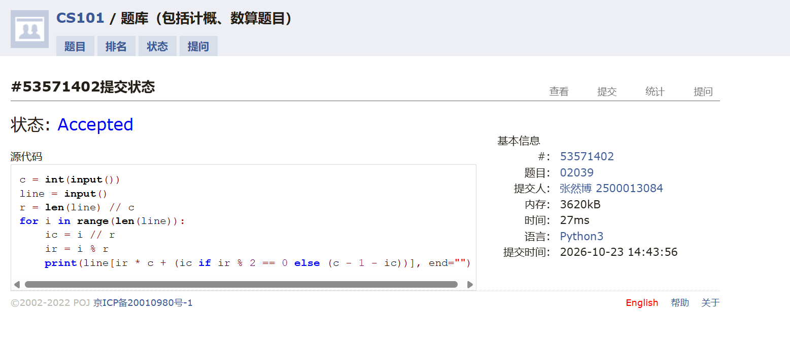
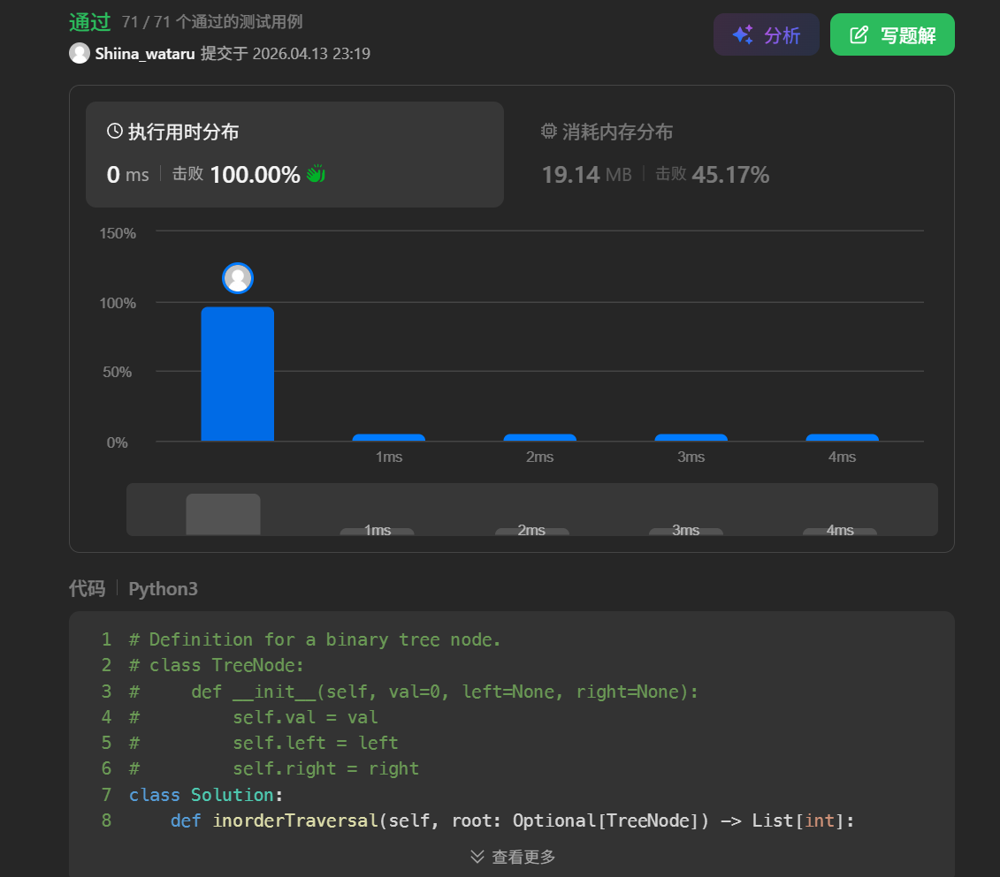
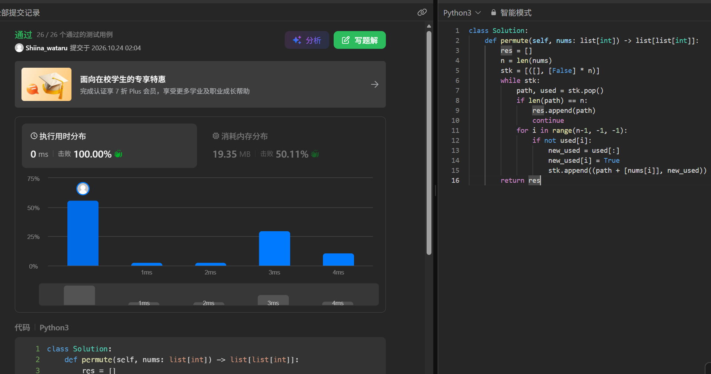
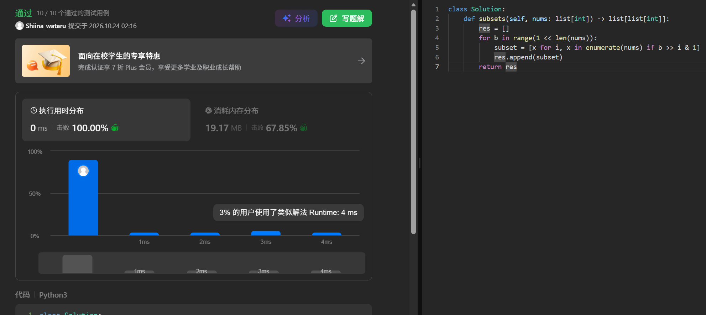
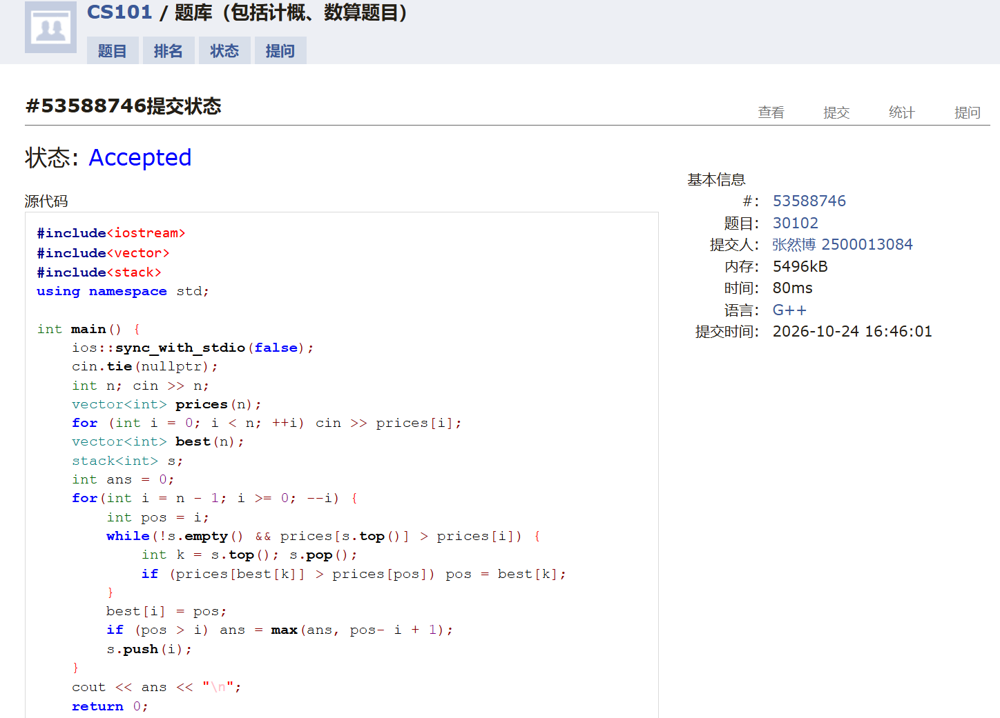

# DSA Assignment #5: 编程练习

*Updated: 2026-10-08 14:50 (GMT+8)*  
*完成学生：<mark>张然博，信息科学技术学院</mark>*


>**说明：**
>
>内容要求：每个题目包含：**解题思路**（可选）、**源代码**、**Accepted 截图**、**预估耗时**（可选）。
>


## 1. 题目

### E02039: 反反复复	

matrix, http://cs101.openjudge.cn/practice/02039/

思路：

找到对应映射关系即可

预估耗时：
27ms


代码

```python
c = int(input())
line = input()
r = len(line) // c
for i in range(len(line)):
    ic = i // r
    ir = i % r
    print(line[ir * c + (ic if ir % 2 == 0 else (c - 1 - ic))], end="")
```


代码运行截图 <mark>（至少包含有"Accepted"）</mark>



### E94.二叉树的中序遍历

dfs, stack, https://leetcode.cn/problems/binary-tree-inorder-traversal/

思路：

按照中序遍历的定义递归

预估耗时：
0ms


代码

```python
# Definition for a binary tree node.
# class TreeNode:
#     def __init__(self, val=0, left=None, right=None):
#         self.val = val
#         self.left = left
#         self.right = right
class Solution:
    def inorderTraversal(self, root: Optional[TreeNode]) -> List[int]:
        if root is None :
            return []
        else :
            return self.inorderTraversal(root.left) + [root.val] + self.inorderTraversal(root.right)
```


代码运行截图 <mark>（至少包含有"Accepted"）</mark>



### M46.全排列

backtracking, https://leetcode.cn/problems/permutations/

思路：

用一个栈来模拟进行回溯，使用 used 数组来标记哪些元素已经被使用过，递归地生成所有排列。

预估耗时：

0ms

代码

```python
class Solution:
    def permute(self, nums: list[int]) -> list[list[int]]:
        res = []
        n = len(nums)
        stk = [([], [False] * n)]
        while stk:
            path, used = stk.pop()
            if len(path) == n:
                res.append(path)
                continue
            for i in range(n-1, -1, -1):
                if not used[i]:
                    new_used = used[:]
                    new_used[i] = True
                    stk.append((path + [nums[i]], new_used))
        return res
```


代码运行截图 <mark>（至少包含有"Accepted"）</mark>



### M78.子集	

backtracking, https://leetcode.cn/problems/subsets/

思路：

使用二进制来表示每个元素是否在子集中，遍历所有可能的二进制数，从而生成所有子集。

预估耗时：

0ms

代码

```python
class Solution:
    def subsets(self, nums: list[int]) -> list[list[int]]:
        res = []
        for b in range(1 << len(nums)):
            subset = [x for i, x in enumerate(nums) if b >> i & 1]
            res.append(subset)
        return res
```


代码运行截图 <mark>（至少包含有"Accepted"）</mark>



### T30201: 旅行售货商问题

bitmask dp, http://cs101.openjudge.cn/practice/30201/

思路：

使用状态压缩dp，我们以一个 n 位的二进制来代表一个状态，每位的 1 代表去过这个城市，0  代表没去过这个城市。dp[s][i] 表示在状态 s 下，最后一个访问的城市是 i 的最短路径长度。我们可以通过遍历所有的状态和城市来更新 dp 数组。

预估耗时：

202ms

代码

```cpp
#include<iostream>
#include<vector>
#include<climits>
using namespace std;

int main() {
    int n; cin >> n;
    vector<vector<int>> cost(n, vector<int>(n));
    for (int i = 0; i < n; ++i) {
        for (int j = 0; j < n; ++j) {
            cin >> cost[i][j];
        }
    }
    int full = 1 << n;
    vector<vector<int>> dp(full, vector<int>(n, INT_MAX));
    dp[0][0] = 0;
    for(int s = 1; s < full; ++s) {
        for(int i = 0; i < n; ++i) {
            if(!(s & (1 << i))) continue;
            int prev = s ^ (1 << i);
            for(int j = 0; j < n; ++j) {
                if(dp[prev][j] != INT_MAX) {
                    dp[s][i] = min(dp[s][i], dp[prev][j] + cost[j][i]);
                }
            }
        }
    }
    cout << dp[full - 1][0] << endl;
    return 0;
}
```


代码运行截图 <mark>（至少包含有"Accepted"）</mark>


### T30102:完美交易窗口

monotonic stack, binary search, http://cs101.openjudge.cn/practice/30102/

思路：

注意到我们对每个位置 $i$，找到其右边第一个小于等于其的位置 $j$，则 $i$ 位置的完美交易窗口一定在这之间，同时寻找这区间内的 $best[i]$ 也就是第一个最大值的出现位置。我们从右往左遍历，使用单调栈来维护当前的最小值位置，同时更新 $best[i]$。

预估耗时：

80ms

代码

```cpp
#include<iostream>
#include<vector>
#include<stack>
using namespace std;

int main() {
    ios::sync_with_stdio(false);
    cin.tie(nullptr);
    int n; cin >> n;
    vector<int> prices(n);
    for (int i = 0; i < n; ++i) cin >> prices[i];
    vector<int> best(n);
    stack<int> s;
    int ans = 0;
    for(int i = n - 1; i >= 0; --i) {
        int pos = i;
        while(!s.empty() && prices[s.top()] > prices[i]) {
            int k = s.top(); s.pop();
            if (prices[best[k]] > prices[pos]) pos = best[k];
        }
        best[i] = pos;
        if (pos > i) ans = max(ans, pos- i + 1);
        s.push(i);
    }
    cout << ans << "\n";
    return 0;
}
```


代码运行截图 <mark>（至少包含有"Accepted"）</mark>



## 2. 学习总结和收获

<mark>如果作业题目简单，有否额外练习题目，比如：OJ“数算2026fall每日选做”、CF、LeetCode、洛谷等网站题目。</mark>

