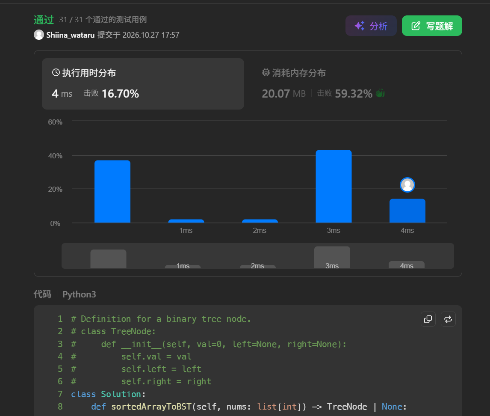
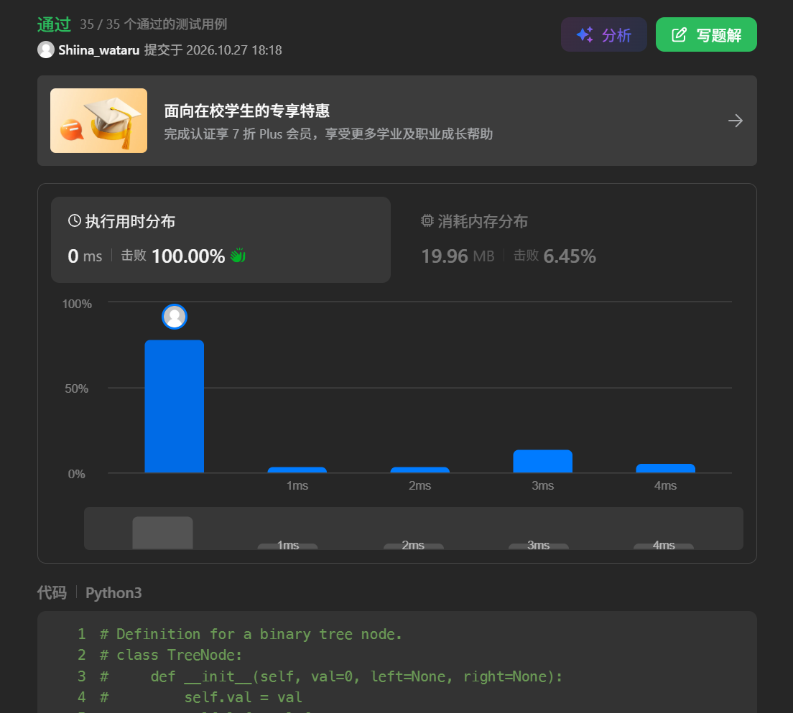
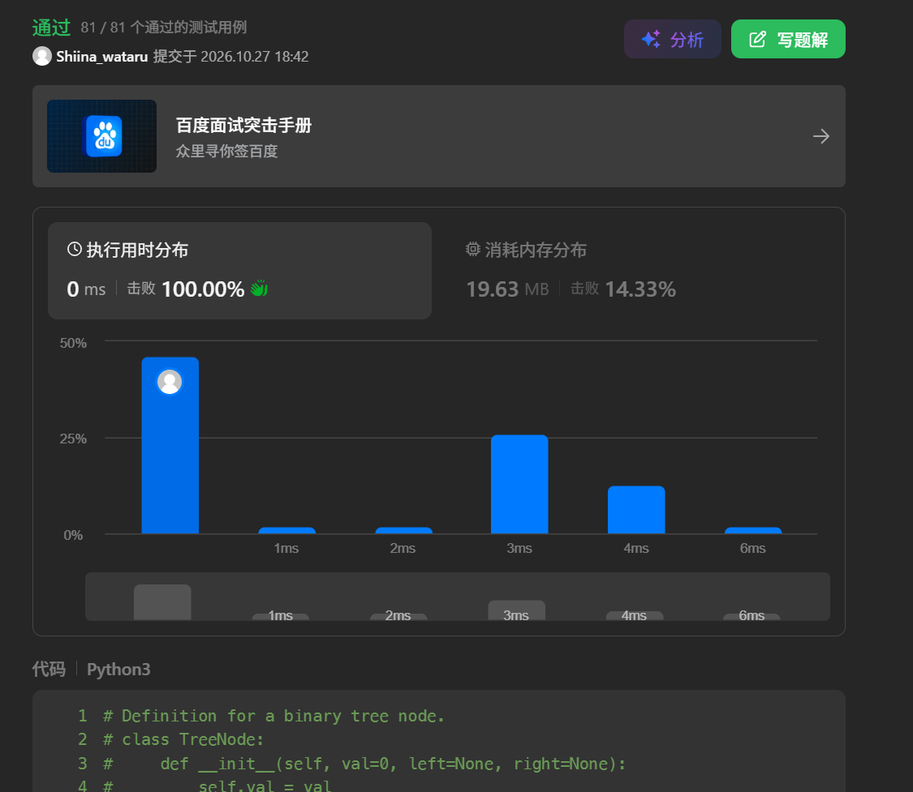
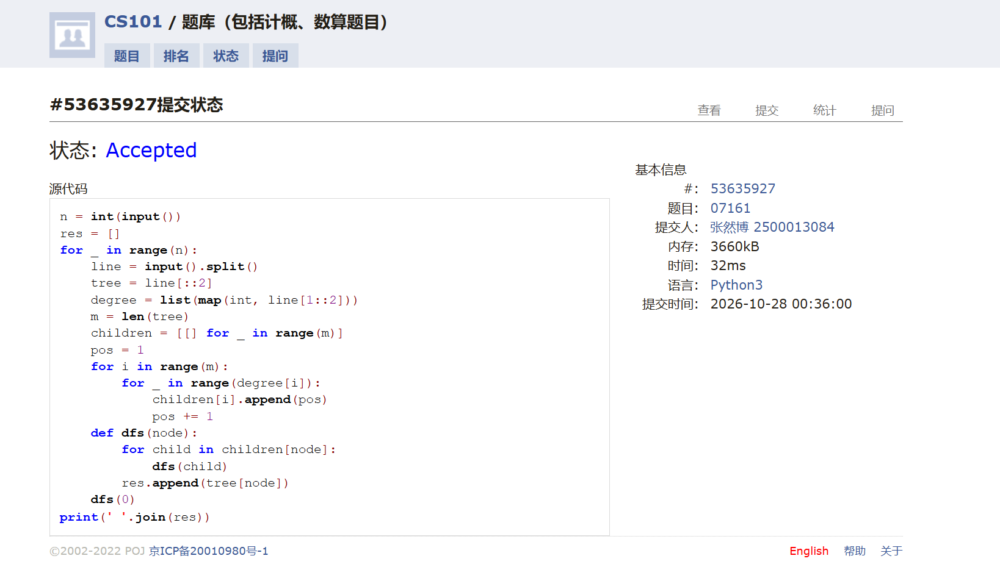
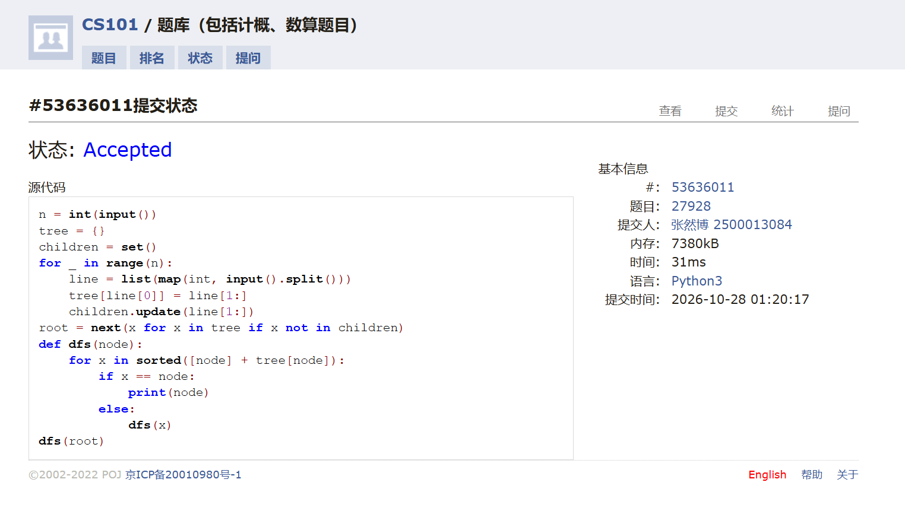
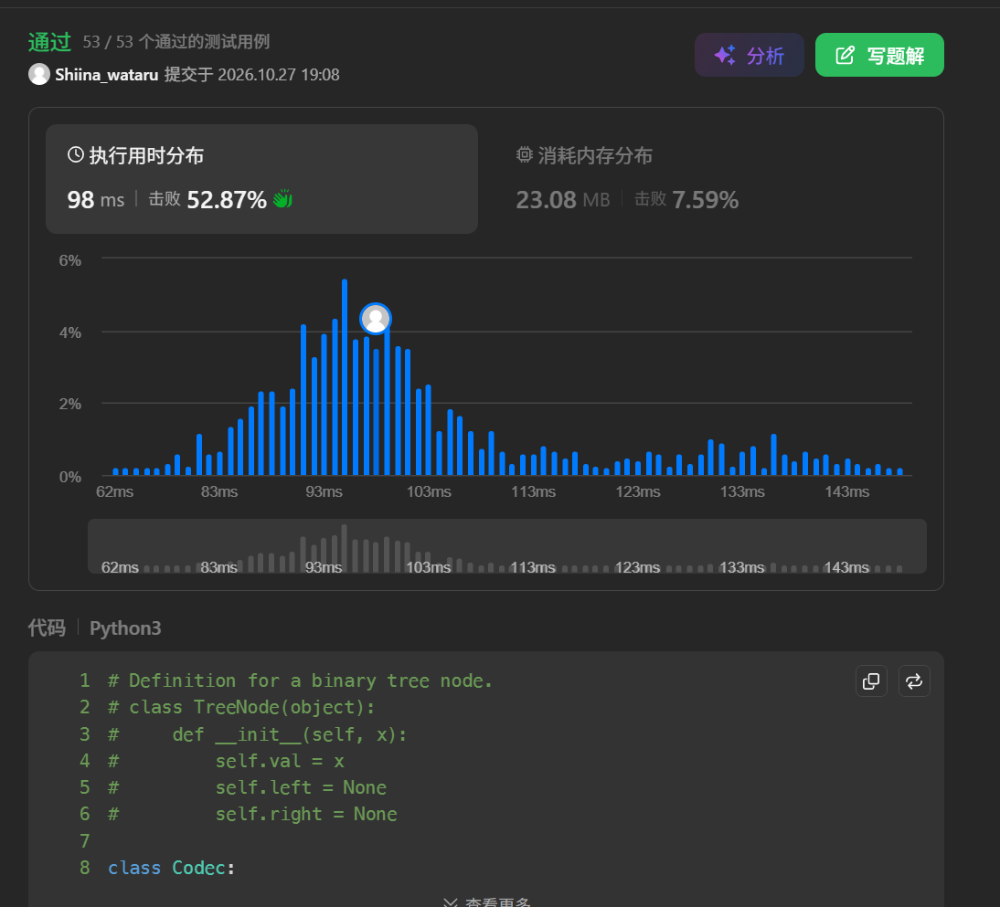

# DSA Assignment #6: 编程练习

*Updated: 2026-10-10 13:50 (GMT+8)*  
*完成学生：<mark>张然博，信息科学技术学院</mark>*


>**说明：**
>
>内容要求：每个题目包含：**解题思路**（可选）、**源代码**、**Accepted 截图**、**预估耗时**（可选）。
>


## 1. 题目

### E108.将有序数组转换为二叉搜索树

https://leetcode.cn/problems/convert-sorted-array-to-binary-search-tree/

思路：

选择节点的中间元素作为根节点，左子树为左半部分数组构成的二叉搜索树，右子树为右半部分数组构成的二叉搜索树。递归实现。

预估耗时：

4ms

代码

```python
# Definition for a binary tree node.
# class TreeNode:
#     def __init__(self, val=0, left=None, right=None):
#         self.val = val
#         self.left = left
#         self.right = right
class Solution:
    def sortedArrayToBST(self, nums: list[int]) -> TreeNode | None:
        if not nums: return None
        n = len(nums)
        root = TreeNode(nums[n // 2])
        root.left = self.sortedArrayToBST(nums[: n // 2])
        root.right = self.sortedArrayToBST(nums[n // 2 + 1:])
        return root
```


代码运行截图 <mark>（至少包含有"Accepted"）</mark>



### M102.二叉树的层序遍历

bfs, https://leetcode.cn/problems/binary-tree-level-order-traversal/

思路：

使用队列进行广度优先搜索，记录每个节点的深度，将节点值按深度存入结果列表中。

预估耗时：

0ms

代码

```python
# Definition for a binary tree node.
# class TreeNode:
#     def __init__(self, val=0, left=None, right=None):
#         self.val = val
#         self.left = left
#         self.right = right
class Solution:
    def levelOrder(self, root: TreeNode | None) -> list[list[int]]:
        if not root: return []
        q = deque([(root, 1)])
        res = []
        while q:
            cur, depth = q.popleft()
            if depth > len(res):
                res.append([])
            res[depth - 1].append(cur.val)
            if cur.left: q.append((cur.left, depth + 1))
            if cur.right: q.append((cur.right, depth + 1))
        return res
```


代码运行截图 <mark>（至少包含有"Accepted"）</mark>



### M1123.最深叶节点的最近公共祖先

dfs, https://leetcode.cn/problems/lowest-common-ancestor-of-deepest-leaves/

思路：

使用后序遍历，计算每个节点的左右子树的最大深度，如果左右子树的最大深度相等且大于当前记录的最大深度，则更新答案为该节点。

预估耗时：

0ms

代码

```python
# Definition for a binary tree node.
# class TreeNode:
#     def __init__(self, val=0, left=None, right=None):
#         self.val = val
#         self.left = left
#         self.right = right
class Solution:
    def lcaDeepestLeaves(self, root: TreeNode | None) -> TreeNode | None:
        ans = None
        max_depth = 0
        def postorder(root: TreeNode | None, depth: int) -> int:
            nonlocal ans, max_depth
            if not root: return depth
            left_depth = postorder(root.left, depth + 1)
            right_depth = postorder(root.right, depth + 1)
            if left_depth == right_depth and left_depth >= max_depth:
                max_depth = left_depth
                ans = root
            return max(left_depth, right_depth)
        postorder(root, 0)
        return ans
```


代码运行截图 <mark>（至少包含有"Accepted"）</mark>



### M07161: 森林的带度数层次序列存储

tree, http://cs101.openjudge.cn/practice/07161/

思路：

根据层次遍历序列和每个节点的度数恢复树，再进行后根遍历。
1. 建树：用 pos 指向下一个未分配的节点，依次遍历所有节点，根据其度数，将后续对应数量的节点作为它的孩子，建立邻接表。
2. 后根遍历：从根节点开始 DFS，先递归访问所有孩子，再将当前节点加入结果。
3. 对森林中的每棵树重复上述操作，最后输出结果。

预估耗时：

32ms

代码

```python
n = int(input())
res = []
for _ in range(n):
    line = input().split()
    tree = line[::2]
    degree = list(map(int, line[1::2]))
    m = len(tree)
    children = [[] for _ in range(m)]
    pos = 1
    for i in range(m):
        for _ in range(degree[i]):
            children[i].append(pos)
            pos += 1
    def dfs(node):
        for child in children[node]:
            dfs(child)
        res.append(tree[node])
    dfs(0)
print(' '.join(res))
```


代码运行截图 <mark>（至少包含有"Accepted"）</mark>



### M27928: 遍历树

 adjacency list, dfs, http://cs101.openjudge.cn/practice/27928/

思路：

使用邻接表存储树，并寻找到唯一不在任何子节点列表中的节点，也就是根节点，然后使用深度优先搜索（DFS）进行遍历，按照题目要求的顺序输出节点值。

预估耗时：

31ms

代码

```python
n = int(input())
tree = {}
children = set()
for _ in range(n):
    line = list(map(int, input().split()))
    tree[line[0]] = line[1:]
    children.update(line[1:])
root = next(x for x in tree if x not in children)
def dfs(node):
    for x in sorted([node] + tree[node]):
        if x == node:
            print(node)
        else:
            dfs(x)
dfs(root)
```


代码运行截图 <mark>（至少包含有"Accepted"）</mark>



### M297.二叉树的序列化与反序列化

dfs, bfs, https://leetcode.cn/problems/serialize-and-deserialize-binary-tree/

思路：

使用 dfs 递归实现序列化和反序列化，序列化时将节点值按前序遍历顺序存入字符串中，空节点用 "null" 表示；反序列化时根据字符串构建二叉树，如果是 null 则返回 None，否则创建节点并递归构建左右子树。

预估耗时：

98ms

代码

```python
# Definition for a binary tree node.
# class TreeNode(object):
#     def __init__(self, x):
#         self.val = x
#         self.left = None
#         self.right = None

class Codec:

    def serialize(self, root):
        """Encodes a tree to a single string.
        
        :type root: TreeNode
        :rtype: str
        """
        if not root: return "null"
        return f"{root.val},{self.serialize(root.left)},{self.serialize(root.right)}"

    def deserialize(self, data):
        """Decodes your encoded data to tree.
        
        :type data: str
        :rtype: TreeNode
        """
        lst = iter(data.split(","))
        def build():
            val = next(lst)
            if val == "null": return None
            node = TreeNode(int(val))
            node.left = build()
            node.right = build()
            return node
        return build()

# Your Codec object will be instantiated and called as such:
# ser = Codec()
# deser = Codec()
# ans = deser.deserialize(ser.serialize(root))
```


代码运行截图 <mark>（至少包含有"Accepted"）</mark>



## 2. 学习总结和收获

<mark>如果作业题目简单，有否额外练习题目，比如：OJ“数算2026fall每日选做”、CF、LeetCode、洛谷等网站题目。</mark>

